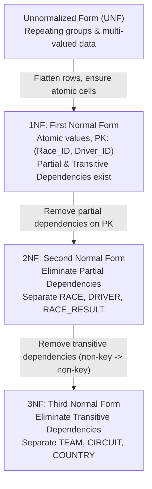
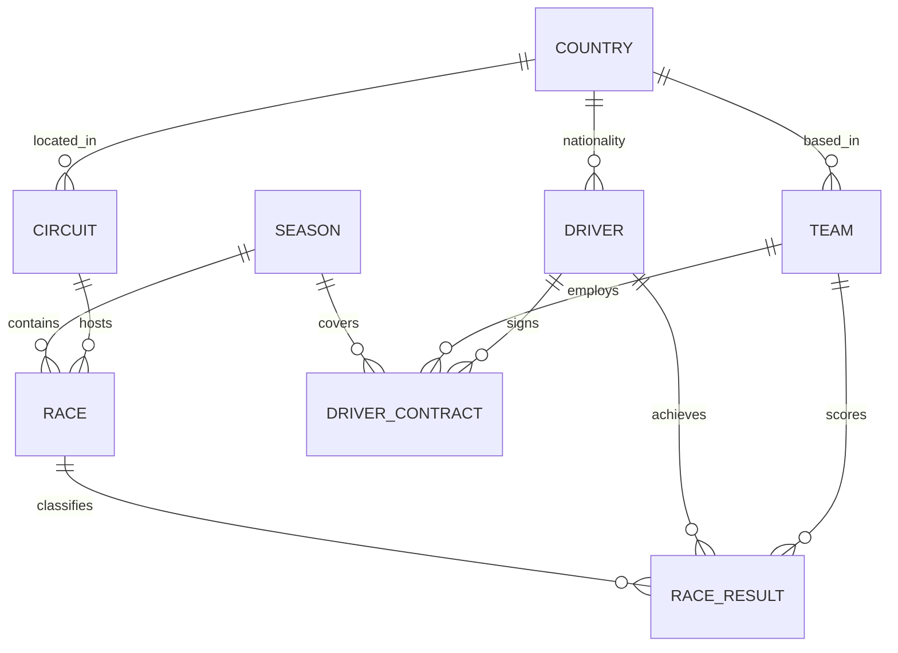

# Before Normalization vs After Normalization

This document provides a comprehensive technical demonstration of database normalization for the **F1 Championship Management & Analytics** system prepared for **DBMS Review 1**.

> [!NOTE]
> **Clarification of Illustrative Modeling:**  
> The unnormalized relation presented in Section 1 is an **illustrative teaching model** constructed specifically to demonstrate relational database anomalies, functional dependencies, and the step-by-step mathematical decomposition through 1NF, 2NF, and 3NF. It does not represent a legacy or historical schema of this project; the production database was engineered directly in **Third Normal Form (3NF)** (see [`database/01_schema.sql`](file:///e:/F1-Championship-Management/database/01_schema.sql)).

---

## 1. Before Normalization: The Unnormalized Form (UNF)

In an unnormalized design, all data related to a Grand Prix weekend—including race scheduling, circuit location, driver identity, team constructors, and race results—is bundled into a single wide relation or spreadsheet.

### 1.1 Illustrative Unnormalized Table Structure

```
UNNORMALIZED_RACE_RESULTS (
    Race_ID,
    Race_Name,
    Season,
    Circuit_Name,
    Circuit_Country,
    Driver_ID,
    Driver_Name,
    Team_ID,
    Team_Name,
    Finishing_Position,
    Points
)
```

### 1.2 Illustrative Sample Data (Unnormalized Table)

The sample data below illustrates how race metadata, circuit details, driver identities, and team names are needlessly repeated on every finishing row:

| Race_ID | Race_Name | Season | Circuit_Name | Circuit_Country | Driver_ID | Driver_Name | Team_ID | Team_Name | Finishing_Position | Points |
| :--- | :--- | :--- | :--- | :--- | :--- | :--- | :--- | :--- | :--- | :--- |
| **R01** | Bahrain Grand Prix | 2024 | Sakhir Circuit | Bahrain | **D01** | Max Verstappen | **T01** | Red Bull Racing | 1 | 26 |
| **R01** | Bahrain Grand Prix | 2024 | Sakhir Circuit | Bahrain | **D02** | Sergio Perez | **T01** | Red Bull Racing | 2 | 18 |
| **R01** | Bahrain Grand Prix | 2024 | Sakhir Circuit | Bahrain | **D03** | Carlos Sainz | **T02** | Scuderia Ferrari | 3 | 15 |
| **R01** | Bahrain Grand Prix | 2024 | Sakhir Circuit | Bahrain | **D04** | Charles Leclerc | **T02** | Scuderia Ferrari | 4 | 12 |
| **R02** | Saudi Arabian Grand Prix | 2024 | Jeddah Corniche | Saudi Arabia | **D01** | Max Verstappen | **T01** | Red Bull Racing | 1 | 25 |
| **R02** | Saudi Arabian Grand Prix | 2024 | Jeddah Corniche | Saudi Arabia | **D02** | Sergio Perez | **T01** | Red Bull Racing | 2 | 18 |
| **R02** | Saudi Arabian Grand Prix | 2024 | Jeddah Corniche | Saudi Arabia | **D04** | Charles Leclerc | **T02** | Scuderia Ferrari | 3 | 15 |
| **R02** | Saudi Arabian Grand Prix | 2024 | Jeddah Corniche | Saudi Arabia | **D38** | Oliver Bearman | **T02** | Scuderia Ferrari | 7 | 6 |

*(Data is illustrative for educational demonstration; points and positions reflect simplified results).*

---

## 2. Problems with the Unnormalized Design

The unnormalized structure suffers from four fundamental database anomalies:

### 2.1 Severe Data Redundancy
- **Race and Circuit Duplication**: For a single Grand Prix with 20 drivers classified, the race name (`Bahrain Grand Prix`), season (`2024`), circuit (`Sakhir Circuit`), and country (`Bahrain`) are stored **20 times**. Across a 24-race season, race and track metadata is duplicated **480 times**.
- **Driver and Team Duplication**: Driver names and team names are re-typed across every single session of the championship calendar, consuming redundant disk storage and memory buffers.

### 2.2 Insertion Anomaly
- **Cannot register a driver without a race result**: If a team signs a new test or reserve driver (e.g., Oliver Bearman before Round 2) who has not yet competed in a race, we cannot store the driver's profile without setting `Race_ID` to `NULL`. Since `Race_ID` forms part of the candidate key, this violates entity integrity.
- **Cannot create a newly announced team or sponsor**: A newly registered constructor cannot exist in the database until they participate and finish a Grand Prix.
- **Cannot schedule the championship calendar in advance**: If a new Grand Prix and circuit are added to the calendar for next season, they cannot be inserted without inserting dummy driver records or filling classification attributes with `NULL`s.

### 2.3 Update Anomaly
- **Constructor Rebranding or Team Name Correction**: If a team changes its operational name (e.g., *AlphaTauri* rebranding to *RB*, or *Sauber* becoming *Kick Sauber*), or if a team changes primary sponsorship, thousands of historical rows must be simultaneously located and updated.
- **Risk of Inconsistency**: If an `UPDATE` statement fails midway or misses rows due to locking or network interruption, the database enters an inconsistent state where the same team has different names in different rounds.

### 2.4 Deletion Anomaly
- **Loss of Independent Facts**: If a race is retroactively cancelled, or if all results for a particular Grand Prix are cleared due to administrative sanction, deleting those result rows inadvertently deletes all record of the race itself and the circuit where it took place.
- **Loss of Driver Profiles**: If a substitute driver competes in only one Grand Prix throughout their entire career (such as a single emergency appearance) and that race result is deleted, all records of that driver's identity, name, and presence vanish from the system entirely.

---

## 3. Step-by-Step Normalization Process

Normalization decomposes the unnormalized relation into smaller, well-structured relations by isolating functional dependencies and eliminating redundancy.



---

### 3.1 First Normal Form (1NF)

#### Principle
> A relation is in **1NF** if and only if all attribute values are atomic (indivisible) and there are no repeating groups or nested relations. A primary key must be defined to uniquely identify each tuple.

In the raw unnormalized concept, a race record might hold an array of driver results:
$$\text{RACE\_RECORD}(\text{Race\_ID}, \text{Race\_Name}, \text{Season}, \text{Circuit}, [\text{Driver}_1, \text{Driver}_2, \dots])$$

To convert to 1NF:
1. Eliminate repeating arrays by flattening every result into an individual row.
2. Ensure each cell contains exactly one scalar value.
3. Establish a primary key: composite key **`(Race_ID, Driver_ID)`**.

#### 1NF Relation
$$\text{RACE\_RESULTS\_1NF}(\underline{\text{Race\_ID}}, \text{Race\_Name}, \text{Season}, \text{Circuit\_Name}, \text{Circuit\_Country}, \underline{\text{Driver\_ID}}, \text{Driver\_Name}, \text{Team\_ID}, \text{Team\_Name}, \text{Finishing\_Position}, \text{Points})$$

- **Primary Key**: `(Race_ID, Driver_ID)`

#### Functional Dependencies Present in 1NF:
1. **Full Functional Dependency on Composite PK**:
   $$\{\text{Race\_ID}, \text{Driver\_ID}\} \rightarrow \text{Team\_ID}, \text{Finishing\_Position}, \text{Points}$$
2. **Partial Functional Dependencies** (depend on only part of the candidate key):
   $$\text{Race\_ID} \rightarrow \text{Race\_Name}, \text{Season}, \text{Circuit\_Name}, \text{Circuit\_Country}$$
   $$\text{Driver\_ID} \rightarrow \text{Driver\_Name}$$
3. **Transitive Functional Dependencies**:
   $$\text{Team\_ID} \rightarrow \text{Team\_Name}$$
   $$\text{Circuit\_Name} \rightarrow \text{Circuit\_Country}$$

#### Problem Addressed
Repeating groups are removed, but partial dependencies still cause severe anomalies and data redundancy.

---

### 3.2 Second Normal Form (2NF)

#### Principle
> A relation is in **2NF** if and only if it is in 1NF and **no non-prime attribute is partially dependent on any candidate key**. Every non-key attribute must be fully functionally dependent on the primary key.

#### Addressing Partial Dependencies
In `RACE_RESULTS_1NF`, the attributes `Race_Name`, `Season`, `Circuit_Name`, and `Circuit_Country` depend only on `Race_ID`, not on `Driver_ID`. Similarly, `Driver_Name` depends only on `Driver_ID`.

To achieve 2NF, we decompose the table into three relations based on their determinants:

#### 2NF Relations

1. **`RACE_2NF`**
   - **Schema**: $(\underline{\text{Race\_ID}}, \text{Race\_Name}, \text{Season}, \text{Circuit\_Name}, \text{Circuit\_Country})$
   - **Primary Key**: `Race_ID`
   - **FD**: $\text{Race\_ID} \rightarrow \text{Race\_Name}, \text{Season}, \text{Circuit\_Name}, \text{Circuit\_Country}$

2. **`DRIVER_2NF`**
   - **Schema**: $(\underline{\text{Driver\_ID}}, \text{Driver\_Name})$
   - **Primary Key**: `Driver_ID`
   - **FD**: $\text{Driver\_ID} \rightarrow \text{Driver\_Name}$

3. **`RACE_RESULT_2NF`**
   - **Schema**: $(\underline{\text{Race\_ID}}, \underline{\text{Driver\_ID}}, \text{Team\_ID}, \text{Team\_Name}, \text{Finishing\_Position}, \text{Points})$
   - **Primary Key**: `(Race_ID, Driver_ID)`
   - **Foreign Keys**:
     - `Race_ID` references `RACE_2NF(Race_ID)`
     - `Driver_ID` references `DRIVER_2NF(Driver_ID)`
   - **FD**: $\{\text{Race\_ID}, \text{Driver\_ID}\} \rightarrow \text{Team\_ID}, \text{Finishing\_Position}, \text{Points}$

#### Problem Addressed
- Race metadata is stored once per race.
- Driver names are stored once per driver.
- We can now insert a driver without registering a race result, and create a race without entering driver classifications.
- **Remaining Problem**: Transitive dependencies still exist. In `RACE_RESULT_2NF`, `Team_Name` depends on `Team_ID` ($\{\text{Race\_ID}, \text{Driver\_ID}\} \rightarrow \text{Team\_ID} \rightarrow \text{Team\_Name}$). In `RACE_2NF`, `Circuit_Country` depends on `Circuit_Name`.

---

### 3.3 Third Normal Form (3NF)

#### Principle
> A relation is in **3NF** if and only if it is in 2NF and **no non-prime attribute is transitively dependent on the primary key**.  
> Formally, for every non-trivial functional dependency $X \rightarrow Y$, either:
> 1. $X$ is a superkey, or
> 2. $Y$ is a prime attribute (part of a candidate key).

#### Addressing Transitive Dependencies
1. In `RACE_RESULT_2NF`:
   $$\{\text{Race\_ID}, \text{Driver\_ID}\} \rightarrow \text{Team\_ID} \quad \text{and} \quad \text{Team\_ID} \rightarrow \text{Team\_Name}$$
   Here, `Team_ID` is not a superkey of `RACE_RESULT_2NF`, making `Team_Name` transitively dependent on the primary key.
2. In `RACE_2NF`:
   $$\text{Race\_ID} \rightarrow \text{Circuit\_ID} \quad \text{and} \quad \text{Circuit\_ID} \rightarrow \text{Circuit\_Name}, \text{Country}$$
   `Circuit_Name` and `Country` depend on the circuit, not directly on the race.

We decompose them by moving the transitively dependent attributes to their own relations:

#### 3NF Relations (Teaching Model)

1. **`TEAM`**
   - **Schema**: $(\underline{\text{Team\_ID}}, \text{Team\_Name})$
   - **Primary Key**: `Team_ID`

2. **`CIRCUIT`**
   - **Schema**: $(\underline{\text{Circuit\_ID}}, \text{Circuit\_Name}, \text{Country})$
   - **Primary Key**: `Circuit_ID`

3. **`RACE`**
   - **Schema**: $(\underline{\text{Race\_ID}}, \text{Race\_Name}, \text{Season}, \text{Circuit\_ID})$
   - **Primary Key**: `Race_ID`
   - **Foreign Key**: `Circuit_ID` references `CIRCUIT(Circuit_ID)`

4. **`DRIVER`**
   - **Schema**: $(\underline{\text{Driver\_ID}}, \text{Driver\_Name})$
   - **Primary Key**: `Driver_ID`

5. **`RACE_RESULT`**
   - **Schema**: $(\underline{\text{Race\_ID}}, \underline{\text{Driver\_ID}}, \text{Team\_ID}, \text{Finishing\_Position}, \text{Points})$
   - **Primary Key**: `(Race_ID, Driver_ID)`
   - **Foreign Keys**:
     - `Race_ID` references `RACE(Race_ID)`
     - `Driver_ID` references `DRIVER(Driver_ID)`
     - `Team_ID` references `TEAM(Team_ID)`

#### Problem Addressed
- Every non-key attribute depends strictly on the primary key and nothing else ("the key, the whole key, and nothing but the key").
- Updating a constructor's name requires modifying exactly **one row** in `TEAM`.
- Circuits can be maintained independently of races.

---

## 4. After Normalization: The Actual Project Schema

The production schema for **F1 Championship Management** translates these theoretical 3NF principles into an enterprise-grade Oracle Database design.



### 4.1 Production Relations & Key Constraints

As defined in [`database/01_schema.sql`](file:///e:/F1-Championship-Management/database/01_schema.sql):

| Table Name | Primary Key | Alternate / Unique Keys | Foreign Keys | Key Attributes & Dependencies |
| :--- | :--- | :--- | :--- | :--- |
| **`COUNTRY`** | `country_id` | `country_name`, `country_code` | *(None)* | Normalizes geographical data; eliminates duplicate country names across teams, drivers, and circuits. |
| **`SEASON`** | `season_year` | *(None)* | *(None)* | `start_date`, `end_date`, `notes`. Isolates championship year metadata. |
| **`CIRCUIT`** | `circuit_id` | `circuit_ref` | `country_id → COUNTRY` | `circuit_name`, `locality`, `latitude`, `longitude`. Prevents transitive dependency `RACE → CIRCUIT → COUNTRY`. |
| **`TEAM`** | `team_id` | `constructor_ref`, `team_name` | `country_id → COUNTRY` | `nationality`, `primary_color`. Constructor identity stored once. |
| **`DRIVER`** | `driver_id` | `driver_ref` | `country_id → COUNTRY` | `driver_code`, `permanent_number`, `first_name`, `last_name`, `date_of_birth`. |
| **`DRIVER_CONTRACT`** | `contract_id` | `(driver_id, team_id, season_year)` | `driver_id → DRIVER`<br>`team_id → TEAM`<br>`season_year → SEASON` | `car_number`, `role_note`. Allows mid-season driver substitutions and team transfers. |
| **`RACE`** | `race_id` | `(season_year, round_number)` | `season_year → SEASON`<br>`circuit_id → CIRCUIT` | `race_name`, `race_date`, `race_time_utc`, `has_sprint`. |
| **`RACE_RESULT`** | `result_id` | `(race_id, driver_id, session_type)` | `race_id → RACE`<br>`driver_id → DRIVER`<br>`team_id → TEAM` | `grid_position`, `finish_position`, `position_text`, `classification_status`, `points`, `laps_completed`, `fastest_lap`. |

### 4.2 Key Real-World 3NF Design Decisions

1. **Why `team_id` is Stored Directly on `RACE_RESULT`**:
   - In Formula 1, drivers occasionally switch constructors mid-season (e.g., reserve drivers replacing ill drivers, or mid-season driver swaps).
   - The constructor that scored constructor championship points in a given Grand Prix is an immutable historical fact of that **specific session**, not merely a reflection of the seasonal contract.
   - Storing `team_id` on `RACE_RESULT` satisfies 3NF because the functional dependency holds:
     $$\{\text{race\_id}, \text{driver\_id}, \text{session\_type}\} \rightarrow \text{team\_id}$$

2. **Handling Sprint Races (`session_type`)**:
   - Sprint races take place on the same weekend at the same circuit, but award separate championship points.
   - Adding `session_type` (`'RACE'` vs `'SPRINT'`) to the candidate key `(race_id, driver_id, session_type)` prevents collapsing sprint points into GP rows and avoids adding wide, nullable columns (e.g., `sprint_points`, `sprint_pos`) to the schema, maintaining strict 1NF/2NF atomicity.

3. **Separating `QUALIFYING_RESULT` and `PIT_STOP`**:
   - Qualifying sessions and pit stops have distinct cardinarities: qualifying has session lap times (`q1_time`, `q2_time`, `q3_time`), while pit stops have variable occurrences per race (0 to 4+ stops per driver).
   - Moving pit stops to `PIT_STOP(race_id, driver_id, stop_number)` eliminates repeating groups and keeps `RACE_RESULT` fully normalized.

4. **Eliminating Country Redundancy**:
   - By linking `CIRCUIT`, `TEAM`, and `DRIVER` to `COUNTRY(country_id)`, the schema prevents geographic spelling discrepancies and ensures 3NF compliance without transitive dependencies in race listings.

---

## 5. Comparison Matrix: Before vs After Normalization

| Feature / Metric | Unnormalized Form (UNF) | First Normal Form (1NF) | Second Normal Form (2NF) | Third Normal Form (3NF) / Production Schema |
| :--- | :--- | :--- | :--- | :--- |
| **Repeating Groups / Atomicity** | Non-atomic arrays / multi-valued cells | Atomic scalar values in each row | Atomic scalar values | Atomic scalar values |
| **Primary Key Definition** | Undefined or ambiguous | Composite `(Race_ID, Driver_ID)` | Distinct PKs for each decomposed entity | Surrogate PKs (`_id`) + Natural Alternate Unique Keys |
| **Partial Dependencies** | High | Present ($\text{Race\_ID} \rightarrow \text{Race\_Name}$) | **Eliminated** | **Eliminated** |
| **Transitive Dependencies** | High | Present ($\text{Team\_ID} \rightarrow \text{Team\_Name}$) | Present ($\text{Team\_ID} \rightarrow \text{Team\_Name}$) | **Eliminated** ($\text{Non-key} \rightarrow \text{PK}$ only) |
| **Insertion Anomaly** | Severe (cannot insert driver/race alone) | Severe (candidate key requires both race and driver) | Minimal (can insert race or driver independently) | **None** (entities, tracks, and contracts created independently) |
| **Update Anomaly** | Severe (team name updated in 1,000+ rows) | Severe (repeated team/circuit names) | Moderate (team name repeated in results) | **None** (team name updated in exactly 1 row in `TEAM`) |
| **Deletion Anomaly** | Severe (deleting result deletes race & track) | Severe (deleting result deletes race & track) | Low (deleting result leaves driver & race intact) | **None** (results safely removed without losing track, team, or driver) |
| **Storage Overhead** | Massive duplication of text strings | Massive duplication of text strings | Moderate duplication of foreign keys | **Minimal** (compact numeric foreign keys, zero duplicate strings) |

---

## 6. Faculty Viva Quick Reference (Review 1)

When presenting to faculty or answering viva questions during Review 1, use these concise, technically rigorous answers:

1. **"What is the core difference between 2NF and 3NF?"**  
   - *Answer:* 2NF eliminates **partial dependencies** (where a non-key attribute depends on only part of a composite primary key). 3NF eliminates **transitive dependencies** (where a non-key attribute depends on another non-key attribute rather than directly on the candidate key).

2. **"Why not store Circuit Country directly in the RACE table?"**  
   - *Answer:* That would introduce a transitive dependency: $\text{RACE} \rightarrow \text{CIRCUIT\_ID} \rightarrow \text{COUNTRY\_ID}$. If a circuit is renovated or reassigned, or if multiple races occur at the same track, country information would be duplicated. In 3NF, country belongs to `CIRCUIT` (and `COUNTRY` lookup), not `RACE`.

3. **"Why does RACE_RESULT store TEAM_ID if DRIVER_CONTRACT already links drivers to teams?"**  
   - *Answer:* In F1, drivers can switch teams mid-season (e.g., reserve drivers or driver trades). The team that scored points in a specific race session is an immutable point-in-time fact of that race. Storing `team_id` on `RACE_RESULT` preserves this historical fact while maintaining 3NF because $\{\text{race\_id}, \text{driver\_id}, \text{session\_type}\} \rightarrow \text{team\_id}$.

4. **"How do you prevent duplicate race entries or duplicate results?"**  
   - *Answer:* Through natural composite unique constraints: `UQ_RACE_SEASON_ROUND (season_year, round_number)` on `RACE`, and `UQ_RESULT_DRIVER_SESSION (race_id, driver_id, session_type)` on `RACE_RESULT`.

5. **"Why use surrogate keys (e.g., RACE_ID) if composite natural keys exist?"**  
   - *Answer:* Surrogate identity keys provide compact, fixed-width integer foreign keys that optimize B-tree index performance and simplify joins, while composite natural unique constraints guarantee business-rule data integrity.
